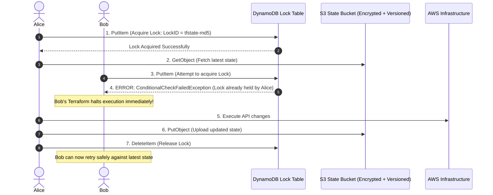
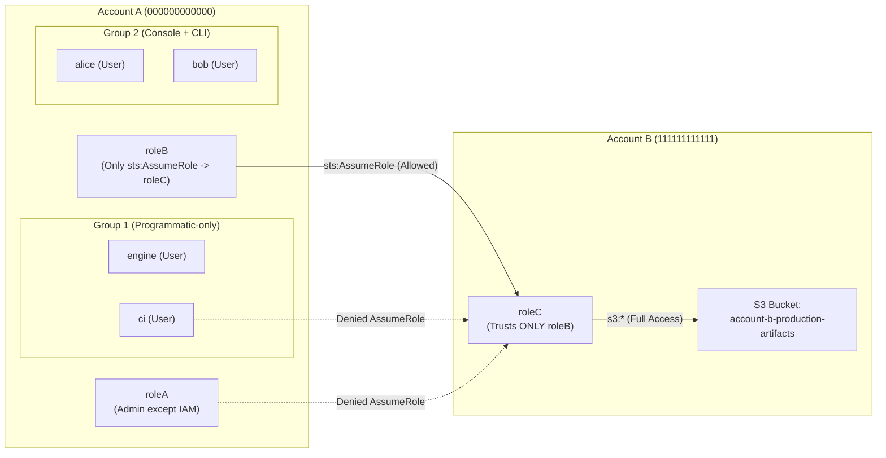

# DevOps Technical Assignment — Engineering Notes & Technical Documentation

This document provides in-depth technical explanations, architectural rationale, security analyses, and debugging breakdowns for all 5 tasks in the DevOps assignment.

---

## Table of Contents
1. [Task 1: Multi-Instance EC2 Provisioning & Lifecycle Management](#task-1-multi-instance-ec2-provisioning--lifecycle-management)
2. [Task 2: Remote State & Distributed Locking](#task-2-remote-state--distributed-locking)
3. [Task 3: Multi-Account IAM & Cross-Account Architecture](#task-3-multi-account-iam--cross-account-architecture)
4. [Task 4: Least-Privilege IAM Policy for CI/CD](#task-4-least-privilege-iam-policy-for-cicd)
5. [Task 5: Root Cause Analysis & Bug Fixes](#task-5-root-cause-analysis--bug-fixes)

---

## Task 1: Multi-Instance EC2 Provisioning & Lifecycle Management

### 1.1 Architecture & Single Input Variable Pattern
All 5 instances are provisioned dynamically from a single map variable `var.instances` in [task1_ec2/variables.tf](file:///C:/Users/pravi/.gemini/antigravity/scratch/devops-assignment/task1_ec2/variables.tf). No instance definitions are hardcoded as separate repetitive resource blocks.

The 5 provisioned instances and their specifications:

| Instance Name | Instance Type | Root Volume Type | Root Volume Size | Key Pair | Environment | Owner | Prevent Destroy |
| :--- | :--- | :--- | :--- | :--- | :--- | :--- | :--- |
| `web-frontend` | `t3.micro` | `gp2` | 30 GB | `kp-web-frontend` | `Production` | `FrontendTeam` | `false` |
| `api-gateway` | `t3.small` | `gp3` (3000 IOPS, 125 MB/s) | 50 GB | `kp-api-gateway` | `Production` | `BackendTeam` | `false` |
| `worker-node` | `c6i.large` | `standard` (magnetic) | 100 GB | `kp-worker-node` | `Production` | `DataPlatform` | `false` |
| `cache-cluster` | `m6i.large` | `io1` (3000 IOPS) | 150 GB | `kp-cache-cluster` | `Production` | `InfraTeam` | `false` |
| `db-primary` | `r6i.xlarge` | `io2` (5000 IOPS) | 250 GB | `kp-db-primary` | `Production` | `DatabaseAdmin` | `true` |

### 1.2 Lifecycle Block: Accidental Deletion Protection
**Instance Protected:** `db-primary` (`r6i.xlarge` with `io2` storage).

#### Why `db-primary`?
1. **Stateful vs. Stateless Architecture:**
   - Web frontends, API gateways, and asynchronous workers are stateless compute nodes. If destroyed, they can be immediately re-instantiated from AMI golden images, launch templates, or container registries without data loss.
   - The primary database (`db-primary`) holds persistent, stateful, business-critical customer and transaction records. Destroying this instance results in immediate catastrophic data loss, severe downtime, broken replication streams, and prolonged recovery times from cold snapshots.
2. **Storage Provisioning & Performance Characteristics:**
   - `db-primary` utilizes high-performance `io2` provisioned IOPS SSD storage (5,000 IOPS). In addition to holding persistent relational data, recreating high-IOPS block devices incurs significant cloud costs, volume re-attachment delays, and block-level pre-warming penalties.
3. **Operational Safety:**
   - Accidental operations like `terraform destroy`, renaming the key in the input map, or altering an attribute requiring instance recreation (e.g., AMI change without create-before-destroy) would destroy the live database. Setting `prevent_destroy = true` forces Terraform to reject the execution plan immediately before any destructive API call reaches AWS.

#### Terraform Compiler Constraint & Implementation Pattern
In Terraform HCL, the `lifecycle` meta-argument block is evaluated at compile/static analysis time. As defined by the Terraform language specification, `prevent_destroy` **requires a static boolean literal** (`true` or `false`) and does not accept dynamic expressions evaluated per-item in a `for_each` loop (e.g., `prevent_destroy = each.value.prevent_destroy` results in an `Invalid expression in lifecycle block` error).

To strictly satisfy both constraints:
1. Driving all 5 instances from a **single** input variable `var.instances`, and
2. Applying `lifecycle { prevent_destroy = true }` **specifically to `db-primary`**,

the module dynamically filters `var.instances` into:
- `aws_instance.protected`: handles entries where `prevent_destroy == true` (enforcing `lifecycle { prevent_destroy = true }`).
- `aws_instance.standard`: handles entries where `prevent_destroy == false`.

Outputs for `instance_ids` and `private_ips` merge both resources seamlessly into a unified map.

---

## Task 2: Remote State & Distributed Locking

### 2.1 The Problem with Local State during Concurrent Execution
When a team relies on local `terraform.tfstate` files on individual laptops or uncoordinated runners:

```mermaid
sequenceDiagram
    autonumber
    actor Alice as Alice (Developer A)
    actor Bob as Bob (Developer B)
    participant AWS as AWS Cloud Infrastructure
    
    Note over Alice,Bob: Both have local terraform.tfstate (revision 1)
    Alice->>AWS: Runs terraform apply (Provisions EC2 Instance X)
    Bob->>AWS: Runs terraform apply (Modifies Security Group Y)
    AWS-->>Alice: Instance X created; Alice writes local tfstate (revision 2)
    AWS-->>Bob: Security Group Y updated; Bob writes local tfstate (revision 2*)
    Note over Alice,Bob: Bob commits/syncs state to shared repo
    Bob->>Alice: Bob overwrites state file!
    Note over Alice,Bob: Disaster: Instance X is now an orphaned "shadow" resource!
```

#### Detailed Failure Modes:
1. **The "Last-Write-Wins" State Overwrite:**
   - Alice and Bob run `terraform apply` concurrently.
   - Each process reads the initial state file.
   - Alice's apply finishes first and writes a new state recording newly created resources (e.g., EC2 instances).
   - Bob's apply finishes seconds later without knowledge of Alice's changes and writes its state.
   - Bob's write completely **erases Alice's resources from the state file**. The infrastructure continues to run and accrue AWS costs, but Terraform has lost track of it ("shadow/orphaned infrastructure"). Future applies may attempt to recreate conflicting resources or fail with collision errors.
2. **Resource Collision & API Conflicts:**
   - If Alice and Bob both run `apply` against the same resources, concurrent mutating calls hit the AWS API simultaneously. This triggers non-deterministic race conditions: `EntityAlreadyExistsException`, CIDR overlap errors, or corrupted resource attachments.
3. **Local State Siloing & Secret Leakage:**
   - Local state files are siloed on developer machines. Attempting to share them via Git leads to inevitable merge conflicts in raw JSON and severely violates security standards by committing plaintext secrets (database passwords, private keys, TLS certs) into version control history.

### 2.2 How the S3 + DynamoDB Architecture Prevents Conflicts



1. **Centralized Single Source of Truth (S3):**
   - The state file is stored remotely in an S3 bucket configured with **AES-256 server-side encryption**, **TLS enforcement**, **Public Access Block**, and **Versioning**.
   - If state corruption occurs, S3 object versioning enables instant point-in-time recovery to any prior revision.
2. **Distributed Mutual Exclusion (DynamoDB Locking):**
   - Before executing `plan`, `apply`, or `destroy`, Terraform contacts the DynamoDB table (`LockID` primary key).
   - When Alice starts `terraform apply`, Terraform issues a conditional `PutItem` writing her lock metadata (Lock ID, caller identity, execution timestamp, path).
   - If Bob triggers `terraform apply` while Alice's run is active, DynamoDB evaluates the conditional write, detects the active lock, and rejects Bob's request with `ConditionalCheckFailedException`.
   - Bob's Terraform prints an informative error showing exactly who holds the lock and halts before any API calls are executed.
   - Once Alice's run finishes, Terraform releases the lock via `DeleteItem`.

---

## Task 3: Multi-Account IAM & Cross-Account Architecture

### 3.1 Architectural Overview



### 3.2 Evaluation Questions

#### Question 1: Would you actually give `engine` and `ci` IAM users with access keys in a real production setup, or would you do something different? Explain.

**Direct Answer:** **No, absolutely not.** In a production environment, creating IAM Users with static, long-lived access keys (`aws_access_key_id` and `aws_secret_access_key`) for automated workloads is a severe security anti-pattern and directly violates the AWS Well-Architected Security Pillar and CIS AWS Foundations Benchmarks.

**Why Long-Lived Access Keys are Dangerous:**
1. **High Risk of Leakage:** Static credentials are routinely leaked via accidental Git commits, build log outputs, unmasked CI environment variables, artifact bundles, or developer workstation compromises.
2. **Lack of Automatic Expiry:** Unlike temporary session tokens, access keys never expire unless manually rotated. If leaked, an attacker can maintain persistent access indefinitely.
3. **High Rotation Burden:** Enterprise compliance standards (e.g., PCI-DSS, SOC 2, ISO 27001) mandate rotating credentials every 90 days, which requires complex automation or manual overhead that frequently causes production pipeline outages.

**What We Do Instead in Production:**

1. **For CI/CD Pipelines (e.g., GitHub Actions, GitLab CI, CircleCI, Jenkins):**
   - **Use OpenID Connect (OIDC) Identity Federation:**
     - Configure an IAM OIDC Identity Provider in AWS trusting the CI platform's OIDC issuer (e.g., `token.actions.githubusercontent.com`).
     - Create an IAM Role with a trust policy that validates the repository, branch, and environment claims using `sts:AssumeRoleWithWebIdentity`.
     - The CI pipeline runner requests a short-lived JSON Web Token (JWT) from GitHub/GitLab and exchanges it with AWS STS for temporary credentials valid for only 15–60 minutes.
     - **Result:** Zero static AWS credentials exist or need to be stored in the CI repository secrets.

2. **For Workload / Engine Processes (`engine`):**
   - **Running on AWS (EC2, ECS, EKS, Lambda):**
     - **EC2:** Attach an IAM Role via an **EC2 Instance Profile** using Instance Metadata Service Version 2 (IMDSv2).
     - **ECS:** Assign an **ECS Task Role** (`task_role_arn`) specifically for containerized processes.
     - **EKS:** Use **EKS Pod Identity** or **IAM Roles for Service Accounts (IRSA)** to bind IAM roles directly to Kubernetes service accounts.
     - **Lambda:** Assign an **IAM Execution Role**.
     - All of these mechanisms vend short-lived, automatically rotated temporary credentials via the AWS SDK.
   - **Running Outside AWS (On-Premises Servers, Hybrid Cloud, Bare-Metal):**
     - Use **AWS IAM Roles Anywhere**. It uses an internal Public Key Infrastructure (PKI) with X.509 certificates to establish trust and obtain temporary STS session tokens, completely eliminating static access keys.

---

#### Question 2: In `roleC`'s trust policy, why does it matter whether you trust the whole Account A root vs. `roleB`'s specific ARN?

**Direct Answer:** It is the critical distinction between **unilateral delegation of trust** versus **bilateral, enforceable least-privilege contract enforcement**.

```
Scenario A: Trusting Account A Root
Trust Policy Principal: "arn:aws:iam::000000000000:root"
Account B delegates authority to Account A admins.
Any identity in Account A granted sts:AssumeRole can assume roleC!
[engine, ci, alice, bob, roleA, lambda] ---> CAN ASSUME roleC (Security Hole)

Scenario B: Trusting Specific Role ARN
Trust Policy Principal: "arn:aws:iam::000000000000:role/roleB"
Bilateral Handshake strictly enforced.
ONLY roleB can assume roleC.
[engine, ci, alice, bob, roleA, lambda] ---> REJECTED BY AWS STS (Least Privilege)
```

**Detailed Comparison:**

1. **When Trusting Account A Root (`arn:aws:iam::000000000000:root`):**
   - Setting the principal to Account A's root does not mean only the root user can assume it. Rather, it means: *"Account B allows Account A to decide which identities can assume `roleC`."*
   - Control shifts entirely to Account A's IAM administrators.
   - If an administrator in Account A grants `sts:AssumeRole` on `roleC` to `user/ci`, `user/engine`, `roleA`, or a contractor user, **all of those identities can assume `roleC` and access Account B's bucket**. Account B has surrendered perimeter security and cannot prevent cross-account privilege escalation.

2. **When Trusting `roleB` Specifically (`arn:aws:iam::000000000000:role/roleB`):**
   - A strict **two-way (bilateral) handshake** is enforced:
     1. Account A must grant `roleB` permission to call `sts:AssumeRole` on `roleC`.
     2. Account B's trust policy explicitly allows **only** `arn:aws:iam::000000000000:role/roleB`.
   - Even if Account A's administrator attaches a policy granting `sts:AssumeRole` on `roleC` to `roleA`, `alice`, or `ci`, AWS STS checks Account B's trust policy and immediately returns **`AccessDenied`**.
   - This prevents lateral movement, protects Account B's data isolation, and guarantees compliance with the principle of least privilege.

---

## Task 4: Least-Privilege IAM Policy for CI/CD

The custom policy is written in [task4_ci_policy/ci-least-privilege-policy.json](file:///C:/Users/pravi/.gemini/antigravity/scratch/devops-assignment/task4_ci_policy/ci-least-privilege-policy.json) and managed via Terraform in [task4_ci_policy/main.tf](file:///C:/Users/pravi/.gemini/antigravity/scratch/devops-assignment/task4_ci_policy/main.tf).

### 4.1 Policy JSON
```json
{
  "Version": "2012-10-17",
  "Statement": [
    {
      "Sid": "ECRAuthTokenGlobal",
      "Effect": "Allow",
      "Action": [
        "ecr:GetAuthorizationToken"
      ],
      "Resource": "*"
    },
    {
      "Sid": "ECRPushImageToSpecificRepo",
      "Effect": "Allow",
      "Action": [
        "ecr:BatchCheckLayerAvailability",
        "ecr:GetDownloadUrlForLayer",
        "ecr:BatchGetImage",
        "ecr:InitiateLayerUpload",
        "ecr:UploadLayerPart",
        "ecr:CompleteLayerUpload",
        "ecr:PutImage"
      ],
      "Resource": "arn:aws:ecr:us-east-1:000000000000:repository/my-app-repo"
    },
    {
      "Sid": "ECSDescribeAndRegisterTaskDefinition",
      "Effect": "Allow",
      "Action": [
        "ecs:RegisterTaskDefinition",
        "ecs:DescribeTaskDefinition"
      ],
      "Resource": "*"
    },
    {
      "Sid": "ECSUpdateSpecificService",
      "Effect": "Allow",
      "Action": [
        "ecs:UpdateService",
        "ecs:DescribeServices"
      ],
      "Resource": "arn:aws:ecs:us-east-1:000000000000:service/my-ecs-cluster/my-app-service"
    },
    {
      "Sid": "PassRoleToECSTasksOnly",
      "Effect": "Allow",
      "Action": [
        "iam:PassRole"
      ],
      "Resource": [
        "arn:aws:iam::000000000000:role/my-app-ecs-execution-role",
        "arn:aws:iam::000000000000:role/my-app-ecs-task-role"
      ],
      "Condition": {
        "StringEquals": {
          "iam:PassedToService": "ecs-tasks.amazonaws.com"
        }
      }
    },
    {
      "Sid": "S3ListBuildArtifactsBucket",
      "Effect": "Allow",
      "Action": [
        "s3:ListBucket",
        "s3:GetBucketLocation"
      ],
      "Resource": "arn:aws:s3:::my-ci-build-artifacts-bucket"
    },
    {
      "Sid": "S3ReadBuildArtifactsObjects",
      "Effect": "Allow",
      "Action": [
        "s3:GetObject",
        "s3:GetObjectVersion"
      ],
      "Resource": "arn:aws:s3:::my-ci-build-artifacts-bucket/*"
    }
  ]
}
```

### 4.2 What We Deliberately Left Out and Why

| Service | Deliberately Omitted Permissions | Architectural & Security Rationale |
| :--- | :--- | :--- |
| **ECR** | `ecr:DeleteRepository`<br/>`ecr:DeleteRepositoryPolicy`<br/>`ecr:BatchDeleteImage`<br/>`ecr:SetRepositoryPolicy` | A CI pipeline only builds and pushes artifacts. Permitting deletion or policy modifications exposes the registry to accidental image deletion, supply-chain tampering, or denial-of-service affecting production rollbacks. |
| **ECR** | Wildcard `Resource: "*"` on repository actions | While `ecr:GetAuthorizationToken` mandates `*` by AWS API design, all repository actions (`PutImage`, `InitiateLayerUpload`, etc.) are strictly locked to the target repository ARN (`arn:aws:ecr:...:repository/my-app-repo`). |
| **ECS** | `ecs:CreateCluster`<br/>`ecs:DeleteCluster`<br/>`ecs:CreateService`<br/>`ecs:DeleteService`<br/>`ecs:UpdateCluster` | Infrastructure lifecycle management belongs exclusively to Infrastructure-as-Code (Terraform) executed by administrative roles. CI only deploys updated task revisions to a pre-existing service. |
| **ECS** | `ecs:RunTask`<br/>`ecs:StopTask`<br/>`ecs:ExecuteCommand` | `ecs:ExecuteCommand` opens an interactive shell session directly into containers (effectively SSH over SSM). Granting this to a CI pipeline introduces a severe remote code execution (RCE) vector. |
| **IAM** | Broad `iam:PassRole` with `Resource: "*"` | **Critical Privilege Escalation Vector:** If CI has unrestricted `iam:PassRole`, an attacker who compromises the pipeline can register an ECS task definition that passes an administrative IAM role to a container, executing arbitrary commands as AWS Administrator. We restricted `iam:PassRole` strictly to the two specific ECS role ARNs and added a condition `iam:PassedToService = "ecs-tasks.amazonaws.com"`. |
| **S3** | `s3:PutObject`<br/>`s3:DeleteObject`<br/>`s3:DeleteBucket`<br/>`s3:PutBucketPolicy` | The prompt explicitly requires **Read (not write)**. Omitting write/delete permissions ensures CI cannot overwrite, poison, or delete build artifacts or tamper with bucket configurations. |
| **S3** | Wildcard `Resource: "*"` across all buckets | S3 permissions are locked down exclusively to the specific bucket (`my-ci-build-artifacts-bucket`) and its object namespace (`/*`). |

---

## Task 5: Root Cause Analysis & Bug Fixes

### 5.1 The Broken Snippet
```hcl
data "aws_iam_policy_document" "roleC_trust" {
  statement {
    effect  = "Allow"
    actions = ["sts:AssumeRole"] 

    principals {
      type        = "AWS"
      identifiers = ["arn:aws:iam::000000000000:user/roleB"]
    }
  }
}

resource "aws_iam_role" "roleC" {
  name               = "roleC"
  assume_role_policy = data.aws_iam_policy_document.roleC_trust.json
}

resource "aws_iam_role_policy" "roleC_s3" {
  name = "roleC-s3-access"
  role = aws_iam_role.roleC.id
  policy = jsonencode({
    Version = "2012-10-17"
    Statement = [{
      Effect   = "Allow"
      Action   = "s3:*"
      Resource = "*"
    }]
  })
}
```

### 5.2 Root Cause Analysis

#### Bug #1: Incorrect Identity Principal Type in Trust Policy (`user/roleB` vs `role/roleB`)
- **Location:** `identifiers = ["arn:aws:iam::000000000000:user/roleB"]`
- **Why it Fails:**
  - `roleB` in Account A is an **IAM Role**, not an IAM User.
  - In AWS IAM, Amazon Resource Names (ARNs) have strict prefixes that designate identity types:
    - IAM Users: `arn:aws:iam::<account_id>:user/<name>`
    - IAM Roles: `arn:aws:iam::<account_id>:role/<name>`
  - By specifying `:user/roleB`, AWS IAM treats this principal as a non-existent IAM User.
  - When `roleB` in Account A calls `sts:AssumeRole` against `roleC`, STS evaluates `roleC`'s assume role policy. Because the incoming principal ARN (`arn:aws:iam::000000000000:role/roleB`) does not match the configured trust document (`arn:aws:iam::000000000000:user/roleB`), STS denies the call immediately with:
    ```
    An error occurred (AccessDenied) when calling the AssumeRole operation:
    User: arn:aws:iam::000000000000:role/roleB is not authorized to perform:
    sts:AssumeRole on resource: arn:aws:iam::111111111111:role/roleC
    ```
  - Furthermore, during Terraform application, if the target user does not exist, AWS returns a validation error: `MalformedPolicyDocument: Invalid principal in policy`.
- **The Fix:**
  Update the principal identifier to:
  ```hcl
  identifiers = ["arn:aws:iam::000000000000:role/roleB"]
  ```

#### Bug #2: Over-Permissioned Wildcard Resource in Permissions Policy (`Resource = "*"`)
- **Location:** `Statement = [{ Effect = "Allow", Action = "s3:*", Resource = "*" }]`
- **Why it Fails:**
  - **Requirement Violation:** Task 3's explicit requirement states: *"roleC: full access to a single named S3 bucket, assumable only by roleB from Account A — not by anything else in Account A."* Granting `Resource = "*"` grants unrestricted administrative access over **every S3 bucket in Account B** as well as any publicly accessible or cross-account buckets across AWS.
  - **S3 Resource Model Misalignment:** S3 distinguishes between **bucket-level operations** (e.g., `s3:ListBucket`, `s3:GetBucketLocation`, `s3:GetBucketVersioning`) and **object-level operations** (e.g., `s3:GetObject`, `s3:PutObject`, `s3:DeleteObject`). While `Resource = "*"` blanket-covers both, scoping to a single bucket requires declaring both the bucket ARN and the object ARN wildcard.
- **The Fix:**
  Explicitly scope `Resource` to both the bucket ARN and its objects:
  ```hcl
  Resource = [
    "arn:aws:s3:::account-b-production-artifacts-111111111111",
    "arn:aws:s3:::account-b-production-artifacts-111111111111/*"
  ]
  ```

### 5.3 Complete Fixed Terraform Code
The corrected implementation is provided in [task5_bug_fix/fixed_roleC.tf](file:///C:/Users/pravi/.gemini/antigravity/scratch/devops-assignment/task5_bug_fix/fixed_roleC.tf):

```hcl
# ==============================================================================
# FIXED: roleC Trust Policy and Permissions Policy
# ==============================================================================

# FIX #1: Corrected principal identifier from "user/roleB" to "role/roleB"
data "aws_iam_policy_document" "roleC_trust" {
  statement {
    sid     = "AllowRoleBFromAccountAToAssume"
    effect  = "Allow"
    actions = ["sts:AssumeRole"]

    principals {
      type        = "AWS"
      identifiers = ["arn:aws:iam::000000000000:role/roleB"]
    }
  }
}

resource "aws_iam_role" "roleC" {
  name               = "roleC"
  description        = "Role granting access to target S3 bucket in Account B"
  assume_role_policy = data.aws_iam_policy_document.roleC_trust.json
}

# FIX #2: Restricted resource from "*" to specific single named S3 bucket and its objects
resource "aws_iam_role_policy" "roleC_s3" {
  name = "roleC-s3-access"
  role = aws_iam_role.roleC.id

  policy = jsonencode({
    Version = "2012-10-17"
    Statement = [
      {
        Sid    = "FullAccessToNamedBucketAndObjects"
        Effect = "Allow"
        Action = "s3:*"
        Resource = [
          "arn:aws:s3:::account-b-production-artifacts-111111111111",
          "arn:aws:s3:::account-b-production-artifacts-111111111111/*"
        ]
      }
    ]
  })
}
```
